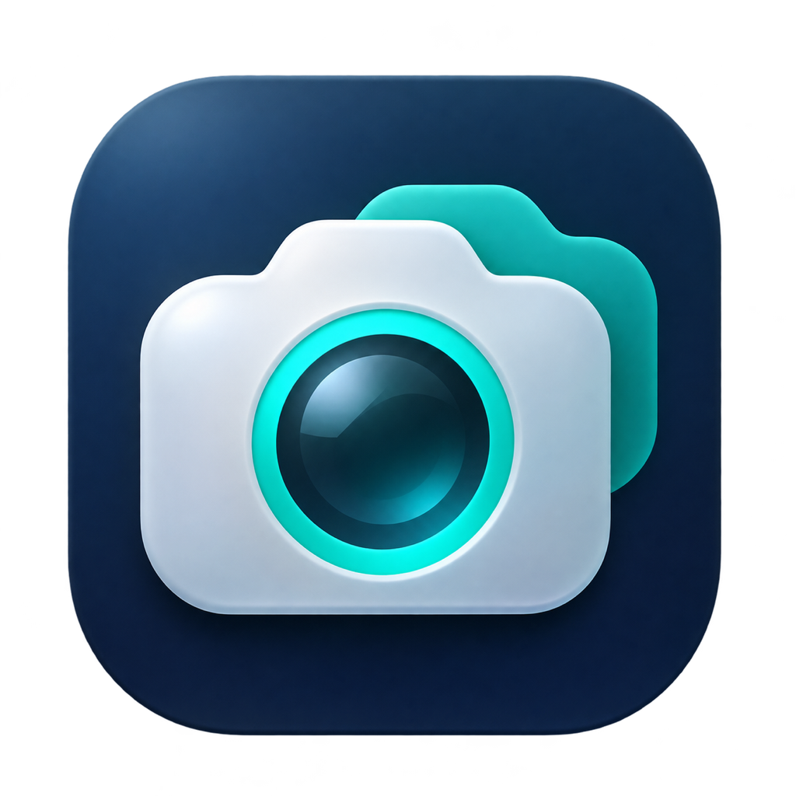

# BetterCam

Native macOS-Webcam-App in SwiftUI mit Kameraauswahl, verarbeiteter Live-Vorschau
und einer CoreMediaIO Camera Extension als virtuelle Kamera **BetterCam**.
Optional ersetzt Apple Vision oder ein importiertes Core-ML-Modell den Hintergrund
durch ein eigenes Bild. Die Ausgabe erfolgt in Full HD (1920 × 1080).
Die Kameraverarbeitung läuft lokal. Optional lassen sich neue Hintergrundbilder
über einen lokalen Codex App Server erzeugen.

Das App-Icon liegt in `App/Assets.xcassets/AppIcon.appiconset` mit allen macOS-Größen
von 16 bis 1024 Pixeln. Xcode erzeugt daraus das Dock-/Finder-Icon; der App-Kopf nutzt
dasselbe Icon. Der Entwurf wurde mit dem integrierten Imagegen-Werkzeug erstellt;
der vollständige Prompt steht in [`assets/bettercam-icon-prompt.txt`](assets/bettercam-icon-prompt.txt).

## Lizenz

BetterCam steht unter der [MIT-Lizenz](LICENSE), Copyright © 2026 Frank Hildebrandt.

Das Projekt bindet keine externen Bibliotheken ein; es verwendet die mit macOS
gelieferten Apple-Frameworks. Für diese gelten weiterhin Apples Lizenzbedingungen.

Die optional herunterladbaren **U²-Net- und U²-NetP-Modelle** sind nicht im Repository
oder App-Bundle enthalten und behalten ihre eigene
[Apache-2.0-Lizenz](https://github.com/xuebinqin/U-2-Net/blob/master/LICENSE).
Die [Core-ML-Konvertierungen](https://github.com/john-rocky/CoreML-Models#u2net)
werden ebenfalls mit dieser Lizenz ausgewiesen. Sie erfordern keine Änderung der
MIT-Lizenz von BetterCam. Bei einer Weiterverteilung der Modelle müssen die
[Apache-2.0-Bedingungen](https://www.apache.org/licenses/LICENSE-2.0#redistribution)
eingehalten werden, insbesondere die Beigabe des Lizenztexts und die Beibehaltung
der einschlägigen Urheberrechts- und gegebenenfalls NOTICE-Hinweise. Für selbst
importierte Modelle gelten die jeweiligen Lizenzen ihrer Anbieter.

## Voraussetzungen

- macOS 14+, Xcode mit Swift 6 und Command Line Tools.
- [XcodeGen](https://github.com/yonaskolb/XcodeGen) zum Neuerzeugen des mitgelieferten Xcode-Projekts (`brew install xcodegen`).
- Für die Installation der virtuellen Kamera: ein Apple Developer Team mit passenden
  Signierungsprofilen für App Groups und System Extensions. Ein unsignierter Build
  kann die Extension nicht aktivieren.

## Bauen und starten

```sh
xcodegen generate
open BetterCam.xcodeproj
```

In Xcode für **alle Targets** dasselbe Development Team wählen. Alternativ eine
nicht eingecheckte `Config/Local.xcconfig` anlegen:

```xcconfig
DEVELOPMENT_TEAM = YOUR_TEAM_ID
```

Um ein vorhandenes **Developer ID Application**-Zertifikat für alle Targets zu
verwenden, zusätzlich in derselben Datei eintragen:

```xcconfig
CODE_SIGN_STYLE = Manual
CODE_SIGN_IDENTITY = Developer ID Application
CODE_SIGN_INJECT_BASE_ENTITLEMENTS = NO
BETTERCAM_APP_PROFILE = BetterCam Developer ID
BETTERCAM_CAMERA_PROFILE = BetterCam Camera Developer ID
```

Die lokale Konfiguration gilt für Debug und Release und bleibt beim Neuerzeugen
des Projekts erhalten. Die beiden Profilnamen müssen zu den lokal installierten
Developer-ID-Profilen passen. Für die App ist **System Extension** erforderlich; die Profile
müssen zu Team, Bundle IDs, Zertifikat und aktivierten Capabilities passen.
Das Zertifikat allein ersetzt diese Berechtigungen nicht. Mit
`xcodebuild -allowProvisioningUpdates` kann Xcode bei manueller Signierung bereits
vorhandene Profile aus dem angemeldeten Konto laden.
Developer-ID-Builds enthalten keine Debugger-Berechtigung (`get-task-allow`). Für
eine Debugger-Sitzung stattdessen ein Development-Zertifikat und Development-Profile
verwenden und die lokale Einstellung `CODE_SIGN_INJECT_BASE_ENTITLEMENTS` entfernen.

Die Bundle IDs sind `de.bettercam.app`, `de.bettercam.camera` und
`de.bettercam.CodexServer` (eingebetteter XPC-Dienst). Der XPC-Dienst benötigt kein
eigenes Provisioning-Profil. Falls die App- oder Kamera-ID im
Developer Account nicht verfügbar sind, in `project.yml` ändern und die IDs in
`CameraConfiguration.swift`, `CameraDevice.authorizeProducer`, der App Group und
`CMIOExtensionMachServiceName` entsprechend angleichen. Die gemeinsame App Group
`$(TeamIdentifierPrefix)de.bettercam.camera` muss für beide Targets freigegeben sein.

### Developer-ID-Build für die virtuelle Kamera notarisieren

Eine gültige Developer-ID-Signatur allein reicht für die Systemerweiterung nicht.
Apple verlangt zusätzlich eine Notarisierung. Andernfalls kann die Aktivierung mit
**code signature invalid** scheitern, obwohl `codesign --verify` erfolgreich ist.
Die lokale Vorschau kann dabei weiterhin funktionieren.

Mit dem in Xcode angemeldeten Apple-Developer-Konto:

```sh
xcodebuild -project BetterCam.xcodeproj -scheme BetterCam -configuration Release \
  -archivePath build/notarization/BetterCam.xcarchive archive
xcodebuild -exportArchive -archivePath build/notarization/BetterCam.xcarchive \
  -exportOptionsPlist Config/DeveloperID-Export.plist \
  -exportPath build/notarization/upload -allowProvisioningUpdates
# Nach erfolgreicher Notarisierung:
xcodebuild -exportNotarizedApp -archivePath build/notarization/BetterCam.xcarchive \
  -exportPath build/notarization/release
codesign --verify --deep --strict build/notarization/release/BetterCam.app
codesign --verify --strict build/notarization/release/BetterCam.app/Contents/Library/SystemExtensions/de.bettercam.camera.systemextension
xcrun stapler validate build/notarization/release/BetterCam.app
spctl --assess --type execute --verbose=4 build/notarization/release/BetterCam.app
```

`Config/DeveloperID-Export.plist` verwendet die oben beschriebenen manuellen
Profilnamen und lädt ausschließlich zu Apples Notarisierungsdienst hoch. Es ist
keine Veröffentlichung im App Store. Bei anderen Profilnamen die Zuordnung anpassen.
Erst den erfolgreich notarisierten Export nach `/Applications` kopieren. Für eine
Aktivierungsfreigabe müssen Signaturprüfung, Ticketprüfung und Gatekeeper-Prüfung
erfolgreich sein; `spctl` sollte **Notarized Developer ID** ausgeben. Nach Änderungen
am signierten Programm muss der neue Build erneut notarisiert werden.

Grundlage: [Apple: System Extensions and DriverKit](https://developer.apple.com/videos/play/wwdc2019/702/?time=144),
[Apple: macOS-App zur Notarisierung hochladen](https://help.apple.com/xcode/mac/current/en.lproj/dev88332a81e.html).

1. Schema **BetterCam**, Ziel **My Mac**, bauen.
2. `BetterCam.app` aus dem Build-Verzeichnis nach **/Applications** kopieren.
3. App von dort öffnen und **Virtuelle Kamera aktivieren** klicken.
4. Die Kameraerweiterung in den Systemeinstellungen erlauben. Je nach macOS-Version
   unter **Allgemein → Anmeldeobjekte & Erweiterungen → Kameraerweiterungen** oder
   **Datenschutz & Sicherheit**. macOS kann einen Neustart verlangen.
5. Quelle auswählen, **Kamera starten**, Kamerazugriff erlauben.
6. In der Video-App **BetterCam** als Kamera wählen. Bereits geöffnete Video-Apps
   gegebenenfalls neu starten, damit sie das neue Gerät entdecken.

**Bild auswählen …** lädt einen Hintergrund und aktiviert den Filter. Der Schalter
stellt auf das unveränderte Kamerabild zurück. Kamera stoppen gibt die Hardware frei;
die installierte virtuelle Kamera bleibt verfügbar und liefert Schwarz. Zum Wechseln
der Quelle erst stoppen. Das Hintergrundbild wird nur für die laufende Sitzung gehalten.

## Hintergründe mit Codex erzeugen

Voraussetzung ist eine aktuelle Codex CLI auf **demselben Mac** mit angemeldetem
Konto und verfügbarer Bildgenerierung. Einmalig im Terminal anmelden:

```sh
codex login
```

BetterCam startet den App Server beim Klick auf **Hintergrund erzeugen** automatisch
und beendet den eigenen Prozess nach Erfolg, Fehler, Abbruch oder beim Beenden der
App. Ein offenes Terminal oder ein vorab gestarteter Server ist nicht erforderlich.
Die App sucht Codex im `PATH`, in den üblichen Homebrew-Verzeichnissen, unter
`~/.npm-global/bin` und `~/.local/bin` sowie im installierten Codex-App-Bundle.

1. Unter **Hintergrund → Hintergrund erzeugen …** auf **Neu** klicken.
2. Einen Profilnamen und den **Pre-Prompt** mit den festen Vorgaben eintragen,
   beispielsweise Raumstil, Farben oder Markenregeln.
3. Optional über **Bilder hinzufügen …** Logos, Stilvorlagen und andere
   Referenzbilder importieren. BetterCam speichert eigene PNG-Kopien; die
   ursprünglichen Dateien müssen anschließend nicht mehr verfügbar sein.
4. **Profil speichern**, das Profil auswählen und bei Bedarf im Feld
   **Zusätzlicher Kontext** die Wünsche für dieses einzelne Bild ergänzen.
5. **Hintergrund erzeugen** klicken. Das fertige Bild wird als Kamerahintergrund
   aktiviert. Die Kamera muss zum Generieren nicht laufen.

Pre-Prompt und **alle** Profilbilder werden bei jeder Generierung erneut
übergeben. Der Zusatzkontext kann leer bleiben. Profile können über die
Stift-Schaltfläche bearbeitet oder über den Papierkorb gelöscht werden.
Über **Hintergrund → Mediathek …** oder **Mediathek öffnen …** im Generator lassen
sich alle erzeugten Bilder anhand ihrer Vorschau auswählen. Ein Klick aktiviert
das Bild als Kamerahintergrund; das aktive Bild ist markiert. Neue Bilder werden
automatisch dauerhaft gespeichert, die neuesten stehen zuerst. Sie bleiben auch
nach einem App-Neustart und nach dem Löschen des zugehörigen Profils verfügbar.
Ein bereits vorhandenes `last-background.png` wird einmalig in die Mediathek übernommen.

Profile, importierte Bilder und die Mediathek liegen im
Application-Support-Verzeichnis der App unter `BetterCam/Backgrounds`.
Das ausgewählte Profil und die Codex-Verbindungseinstellungen bleiben nach einem Neustart erhalten;
der aktive Kamerahintergrund wird weiterhin pro Sitzung gesetzt.

Unter **Codex App Server** ist **Codex automatisch bei Bedarf starten** standardmäßig
aktiviert. Ein eingebetteter, separat signierter XPC-Dienst startet
`codex app-server --listen stdio://` und transportiert dessen JSON-RPC-Nachrichten
über Pipes. Der Hilfsdienst läuft außerhalb der App-Sandbox, damit Codex auf seine
bestehende Anmeldung und Konfiguration zugreifen kann. BetterCam selbst und die
Kameraerweiterung behalten ihre macOS-Sandbox; die Kameraerweiterung erhält keinen
Netzwerkzugriff. Es wird kein API-Key in BetterCam gespeichert.

Wer einen eigenen App Server verwenden möchte, deaktiviert den automatischen Start
und trägt eine lokale WebSocket-Adresse ein, beispielsweise `ws://127.0.0.1:4500`.
Diesen Server mit `codex app-server --listen ws://127.0.0.1:4500` selbst starten.
Die App akzeptiert ausschließlich Loopback-Adressen und beendet extern gestartete
Server nicht.
Für jede Generierung wird ein eigener temporärer Thread mit `workspace-write` und
`approvalPolicy: never` angelegt. Interaktive Freigabeanfragen werden abgelehnt.
**Abbrechen** unterbricht den laufenden Turn. Bei Fehlern bleibt das bisherige
Kamerahintergrundbild aktiv.

Zur Bildgenerierung werden Pre-Prompt, Zusatzkontext und Profilbilder über Codex
an OpenAI übertragen. Die laufenden Kamerabilder werden dafür nicht verwendet.
Bildgenerierung muss vom verwendeten Codex-Konto unterstützt werden; BetterCam
zeigt Fehler des Servers an. Der optionale WebSocket-Transport des App Servers ist
experimentell. Protokollgrundlage: [offizielle OpenAI-Dokumentation zum Codex App Server](https://learn.chatgpt.com/docs/app-server).

## Konfiguration und Modellauswahl

**Konfiguration …** in der Seitenleiste oder **BetterCam → Einstellungen …** (`⌘,`)
öffnet die native Konfigurationsseite. Unter **Bilderkennung → Modell** stehen
**Apple Vision**, **U²-NetP**, **U²-Net** und eigene importierte Modelle zur Auswahl. Die Auswahl gilt für Vorschau
und virtuelle Kamera und bleibt nach einem Neustart erhalten.

Apple Vision ist der Standard und benötigt keinen Download. **U²-NetP** ist die
empfohlene kleine Alternative für einen ersten Live-Versuch; **U²-Net** ist die größere
Variante für einen Qualitätsvergleich. Die Auswahl eines noch nicht installierten
Modells oder **Herunterladen und verwenden** startet den Download mit Fortschritt und
Abbruchmöglichkeit. Erst nach Größen-/SHA-256-Prüfung, Kompilierung und erfolgreicher
Testinferenz wird das neue Modell aktiviert. Währenddessen bleibt die bisherige
Auswahl erhalten. Fehler und Abbrechen ändern sie nicht. Bereits heruntergeladene
Modelle bleiben gespeichert und lassen sich ohne erneuten Download auswählen.

Die Core-ML-Konvertierungen stammen aus [john-rocky/CoreML-Models](https://github.com/john-rocky/CoreML-Models#u2net),
das von den [U²-Net-Autoren](https://github.com/xuebinqin/U-2-Net) verlinkt wird. Beide
Modelle stehen unter [Apache-2.0](https://github.com/xuebinqin/U-2-Net/blob/master/LICENSE).
Die Modellkarte zeigt Dateigröße, Lizenz und Quelle. Downloads erfolgen direkt vom
verlinkten Google-Drive-Host; Kamerabilder werden nicht hochgeladen. Der Katalog enthält
feste Dateigrößen und Prüfsummen in `SegmentationModelCatalog.swift`.

Beide Modelle segmentieren allgemeine Vordergrundobjekte bildweise und besitzen
keine Videoverfolgung. Auf dem bereitgestellten Testbild bleiben Person und Mikrofon
erhalten; Stuhl und Mikrofonarm werden teilweise entfernt. Eine vollständige Erhaltung
dieser Gegenstände oder flackerfreie Masken ist damit nicht zugesagt. Schutzmarkierungen
bleiben verfügbar. Die Ausgabe ist weiterhin Full HD; die Modellanalyse erfolgt bei
320 × 320 Pixeln. Die Bildrate hängt vom Mac und der gesamten Verarbeitung ab.

**Modell importieren …**
übernimmt ein eigenes Core-ML-Modell (`.mlmodel`, `.mlpackage` oder `.mlmodelc`),
prüft seine Schnittstelle und aktiviert es nach erfolgreichem Import. Ohne importiertes
Modell öffnet die Auswahl **Eigenes Modell importieren …** den Importdialog. Abbrechen und
fehlgeschlagene Importe behalten die bisherige Auswahl bei. Ein bereits importiertes
Modell lässt sich jederzeit wieder auswählen; Apple Vision bleibt parallel verfügbar.

Das Custom-Modell muss genau einen Bildeingang und eine einzelne Vordergrundmaske
liefern: ein Graustufenbild oder ein einkanaliges Array mit Form `[H, W]`, `[1, H, W]`
oder `[1, 1, H, W]` und Werten von 0 bis 1. Weiß beziehungsweise 1 bedeutet behalten,
Schwarz beziehungsweise 0 bedeutet Hintergrund. Das gesamte Kamerabild wird auf den
Modelleingang skaliert; die Maske wird anschließend auf dieselben Bildkoordinaten
abgebildet. Modelle mit mehreren Klassen, Bildprompts oder zusätzlichen Zuständen
benötigen einen eigenen Adapter. Für die sieben bekannten U²-Net-Ausgänge wird gezielt
die kombinierte Maske `out_p0` verwendet. Beliebige SAM-/PyTorch-Gewichte können nicht direkt
importiert werden. Die App enthält keine Modellgewichte; Katalogmodelle werden auf Wunsch geladen.

Kompilierung und Prüfung laufen außerhalb des UI-Threads. BetterCam speichert eigene
kompilierte Modellkopien unter `Application Support/BetterCam/Segmentation`; die
ursprüngliche Datei muss danach nicht mehr verfügbar sein. Die Verarbeitung läuft
lokal. Bei einem Fehler während der Modellanwendung erscheint die Fehlermeldung im
Kamerafenster; es erfolgt kein stiller Wechsel zu Apple Vision.

Bei Apple Vision lassen sich auf derselben Konfigurationsseite die Erkennung und die
Zubehör-Ergänzung einstellen. Diese Einstellungen bleiben ebenfalls gespeichert.
Die automatische Apple-Zubehör-Heuristik ist beim Custom-Modell ausgeschaltet.
Explizite Schutzmarkierungen gelten weiterhin für beide Varianten.

### Custom-Masken einstellen

Seit Version 0.7 gibt es unter **Maske optimieren** gespeicherte Einstellungen pro
installiertem Modell. Bei U²-Net ist **Ausgewogen** voreingestellt; das kleine U²-NetP
nutzt **Mehr Vordergrund**, weil es auf dem lokalen Testbild andernfalls auch im
Pullover deutlich durchsichtige Bereiche erzeugt. Neu manuell importierte Modelle
beginnen mit **Unverändert**, damit fertige Matting-Modelle ihre eigenen weichen
Alpha-Werte behalten. **Unverändert** schaltet Nachbearbeitung, zusätzliche
Personenerkennung und Stabilisierung vollständig aus.

- **Erkennungsschwelle:** Niedriger behält mehr schwach erkannte Arme und Zubehör,
  kann aber auch Raumobjekte aufnehmen. Höher entfernt mehr unsichere Bereiche.
- **Übergangsbreite:** Schmaler setzt erkannte Flächen früher auf vollständig opak;
  breiter lässt weichere, durchsichtige Übergänge zu. Die Wahrscheinlichkeitswerte
  werden zwischen `Schwelle − Breite/2` und `Schwelle + Breite/2` auf 0 bis 1 abgebildet.
- **Kantenkorrektur:** Positive Werte verkleinern die Maske gegen helle Säume,
  negative erweitern sie. Die Pixelangabe bezieht sich auf 1080 Pixel Ausgabehöhe.
- **Flackern reduzieren:** Hält zuvor sicher erkannten Vordergrund kurz fest, wenn
  die Bildfarbe am gleichen Ort weiterhin passt. Die Haltezeit beträgt höchstens
  120 ms bei 100 %. Neue Vordergrundflächen erscheinen sofort; eigene gehaltene
  Ausgaben verlängern die Historie nicht. Bei nachziehenden Konturen den Wert senken.
- **Person zusätzlich mit Apple erkennen:** Vereinigt die aktuelle Vision-Personenmaske
  mit der Objektmaske vor der Nachbearbeitung. Das kann fehlende Körperbereiche
  ergänzen und benötigt zusätzliche Rechenzeit. Es ist optional und standardmäßig aus.

**Maske nur in Vorschau anzeigen** zeigt Weiß für erhaltene Flächen, Schwarz für
Hintergrund und Grau für Durchsichtigkeit. Dafür muss die Hintergrundersetzung aktiv
sein. Die virtuelle Kamera bekommt weiterhin das gefilterte Farbbild. Der Schutzpinsel
zeigt beim Bearbeiten weiterhin das Original und hat Vorrang vor der Maskenvorschau.

Auf dem ursprünglichen, ungefilterten Testfoto reduzieren die neuen Vorgaben den
hellen Saum und durchsichtige Kleidungsbereiche; Mikrofon-Schaumstoff bleibt erhalten,
die geprüften Tür-/Whiteboardbereiche bleiben ausgeschlossen. Vollständig fehlende
Stuhl-/Arm-/Metallteile lassen sich durch Schwellwerte nicht zurückholen. Die
zusammengesetzte Bildschirmaufnahme liefert keinen Nachweis, dass schnelle Bewegungen
nun sauber freigestellt werden; dafür ist eine neue Live-Prüfung erforderlich.

## Vordergrund und Schutzbereiche

**Konfiguration → Erkennung → Person + Zubehör** ist bei Apple Vision der Standard. Die genaue Vision-Personenmaske
bildet die Basis; daran wird Zubehör gezielt ergänzt. Allgemeine Vision-Instanzen
werden nicht mehr pauschal übernommen, damit Tür oder Whiteboard bei wechselnder
Erkennung nicht als neue Vordergrundobjekte erscheinen. **Nur Person** verwendet
dieselbe Personenmaske ohne die automatische Zubehör-Ergänzung.

**Stuhl & Mikrofon ergänzen** ist im Objektmodus standardmäßig aktiv. Ein lokaler
Algorithmus sucht zusammenhängende dunkle, wenig gesättigte Flächen nahe der bereits
erkannten Person. Schmale farbige Komponenten ergänzen beispielsweise ein Kabel;
kurze Verbindungsstücke überbrücken helle Metallteile. Neue unabhängige Zubehörbereiche
benötigen mindestens drei aufeinanderfolgende Beobachtungen über mindestens 100 ms.
Bestätigtes Zubehör bleibt bei positiver Erkennung auch bei Farbsprüngen erhalten;
seine Farbreferenz folgt laufenden Belichtungsänderungen. Ausblenden benötigt mindestens
drei negative Beobachtungen über 200 ms. Bei deutlich anderem freigelegtem Hintergrund
reichen zwei negative Beobachtungen über mindestens 60 ms. Eine Wiedererkennung vor
der Freigabe gilt sofort. Die Personenmaske selbst wird weder verzögert noch mit alten
Kopfkonturen überblendet.

Seit Version 0.4.2 übernehmen bewegte Komponenten die bestehende Bestätigung in einem
begrenzten Randbereich (2 % der Analysebreite), wenn mindestens 40 % der aktuellen
Komponente mit farblich passenden bestätigten Pixeln überlappen. Unabhängige neue
Bereiche durchlaufen weiterhin die anfängliche Mehrbildprüfung. Szenenwechsel werden
an Hintergrundpixeln außerhalb der aktuellen und vorherigen Personenmaske sowie des
Zubehörs gemessen, damit Personenbewegungen nicht die gesamte Zubehörhistorie löschen.

Seit Version 0.4.1 bleibt die Zubehör-Bestätigung auch dann bestehen, wenn Vision
dasselbe Objekt zwischenzeitlich zur vollständig opaken Personenmaske zählt.
Die akzeptierten Objektkomponenten liefern dafür eigene Evidenz unabhängig vom
Personenalpha. Fällt etwa das Mikrofon später wieder aus der Personenmaske heraus,
ist seine Zubehörmaske bereits bestätigt. Personenalpha allein erzeugt dabei keine
Zubehörhistorie; bestätigte Gegenbelege, fehlender Personenanker und die Reset-Regeln bleiben wirksam.

Komponenten benötigen mehrere Stützpixel im Bereich des Oberkörpers. Kleine dunkle
Flecken und Striche werden nicht als eigenständiges Zubehör ergänzt. Bei zu großen
Erweiterungen werden einzelne Kandidaten abgelehnt, statt die gesamte Zubehörmaske
gleichzeitig aus- und wieder einzuschalten. Die Historie wird bei Stop/Start,
Modus-/Hintergrundwechsel, Zubehör-Umschaltung, neuer Quellgröße, Szenenwechsel,
Segmentierungsfehlern und längeren Frame-Pausen zurückgesetzt. Es werden keine
Koordinaten oder Farben aus dem Testfoto als feste Maske übernommen.

Die Ergänzung ist eine Erscheinungsheuristik, keine semantische Stuhl- oder
Mikrofonerkennung. Große zusätzliche Flächen und Verbindungen zum oberen Bildrand
werden verworfen; dennoch können kleine nahe dunkle Raumobjekte mit aufgenommen
werden. Bei dunklem Hintergrund den Schalter ausschalten oder auf **Nur Person**
mit gezielten Schutzmarkierungen wechseln.

Falls ein Gegenstand verschwindet: **Bereiche behalten** einschalten und im
Originalbild mit dem Pinsel darübermalen. **Pinselgröße**, **Rückgängig** und
**Löschen** korrigieren die Markierung. Anschließend den Bearbeitungsmodus ausschalten;
die Markierungen bleiben aktiv. Die virtuelle Kamera erhält auch während des Markierens
weiter das gefilterte Bild. Schutzbereiche sind feste Bildbereiche und folgen keinen
Objekten: Darin bleibt das gesamte Original sichtbar, einschließlich Raumhintergrund.
Nach einem Kameraschwenk die Markierungen korrigieren; ein Wechsel der Kamera löscht sie.

Die Statuszeile zeigt die tatsächliche Eingangsauflösung und die gemessene
Verarbeitungsbildrate. Wenn die Kamera Full HD nicht unterstützt, wird eine verfügbare
Auflösung verwendet und für die Ausgabe auf Full HD skaliert.

Nach dem Update von 720p auf Full HD die App neu starten und eine bereits installierte
Kameraerweiterung erneut aktivieren, damit auch sie das neue Full-HD-Format bereitstellt.

## Architektur

```text
AVCaptureDevice → AVCaptureVideoDataOutput
  → FrameProcessor (Core Image, Vision-Vordergrundmaske + Schutzbereiche)
  ├─ verarbeitete SwiftUI-Vorschau (bis zu 15 FPS)
  └─ CoreMediaIO Sink-Queue → Camera Extension → Source-Stream
                                              → Video-Apps / Browser
```

- **App/Camera:** Capture und Verarbeitung auf einer seriellen Queue, veraltete
  Eingangsframes werden verworfen. Ausgabe in 1920 × 1080 BGRA, bis zu 30 FPS,
  mit IOSurface-Puffern und begrenztem Pool. Die Extension wird bei Bedarf alle
  zwei Sekunden erneut gesucht, sodass die Vorschau auch ohne Installation läuft.
- **CameraExtension:** stabiles Geräte-/Stream-UUID-Paar und Source-/Sink-Streams.
  Ein Producer gleichzeitig, auf die App-Signatur-ID beschränkt. Die Extension
  konsumiert auch ohne Zuschauer und sendet an alle Kamera-Clients. Ohne aktuelle
  Frames spätestens nach 500 ms Schwarz; beim regulären Stop wird das letzte Bild
  sofort verworfen. Die Kamera gibt keine eigenen Hardware-Captures in Auftrag.
- **Shared:** Ausgabeformat, Seitenverhältnis, Vision-Segmentierung, Schutzmaske,
  Masken-Compositing und Sample-Puffer. Masken werden in normalisierten Koordinaten
  auf das bereits zugeschnittene Kamerabild abgebildet, ohne erneuten Aspect-Fill-Crop.
  `AccessoryMaskRefiner` analysiert Bild und Maske bei 512 Pixeln Breite.
  `AccessoryRegions` ergänzt begrenzt verbundene Komponenten. `AccessoryTemporalFilter`
  bestätigt nur zusätzliche Zubehörpixel; die aktuelle hochauflösende Personenmaske
  und explizite Schutzbereiche bleiben davon unabhängig.
  Weitere Filter werden vor dem Rendern in `FrameProcessor` ergänzt und gelten
  damit gleichzeitig für Vorschau und virtuelle Kamera.

1080p/30 ist das Ausgabeformat, keine garantierte Verarbeitungsleistung. Vision und
Kamerahardware bestimmen die effektive Bildrate; die Extension wiederholt bei kurzen
Lücken den letzten Frame. Die Vision-Analyse arbeitet auf einem verkleinerten Bild
mit maximal 768 Pixeln Breite; die Komposition rendert in Full HD. Segmentierung kann
an Haaren, schnellen Bewegungen oder bei schlechtem Licht sichtbare Kanten erzeugen.
Audio und Aufnahme sind nicht Teil dieses Bootstraps. Für die Aktivierung eines
Developer-ID-Builds der virtuellen Kamera ist der oben beschriebene Notarisierungsweg erforderlich.

## Prüfen

```sh
# Kompiliert App, eingebettete Extension und Codex-XPC-Dienst ohne Apple-Signierung:
xcodebuild -project BetterCam.xcodeproj -scheme BetterCam \
  -configuration Debug -derivedDataPath build CODE_SIGNING_ALLOWED=NO build

# Tests für Bildverarbeitung, Profile, Mediathek, Codex-JSON-RPC und Prozesslebenszyklus:
swift test

# Vergleich aus einem lokalen Kamerabild (optional: Screenshot-Crop in Pixeln ab links oben):
swiftc -O -swift-version 6 Shared/*.swift Shared/Segmentation/*.swift Tools/InspectMask.swift -o /tmp/inspect-mask
/tmp/inspect-mask /path/to/camera.png build/mask-evaluation
# /tmp/inspect-mask /path/to/window.png build/mask-evaluation 336 136 681 383

# Optionaler echter Netzwerk-/Modelltest (lädt beide Katalogmodelle, etwa 181 MB):
swiftc -O -swift-version 6 Shared/*.swift Shared/Segmentation/*.swift Tools/VerifyModelCatalog.swift -o /tmp/verify-model-catalog
/tmp/verify-model-catalog build/catalog-verification --all
```

Das Diagnosewerkzeug erzeugt `before.png`, `after.png` und `mask.png` lokal und
schaltet keine Kamera ein. Eigene Kamerabilder gehören nicht ins Git-Repository;
der Ausgabeordner `build/` ist ignoriert. Die Tests decken unter anderem Stuhl,
Arm, farbiges Kabel, kurze Verbinder, unveränderte weiche Personenränder und
abgelehnte dunkle Hintergrundflächen ab. Zeitliche Regressionstests prüfen positive
Erkennung bei Farbdrift, kurze Erkennungslücken, bestätigte Entfernung, bewegte
Mikrofonkanten und den Wechsel zwischen Personen- und Zubehörmaske.

Ein erfolgreicher Build und diese Tests ersetzen keinen Installationstest. Für den
End-to-End-Test auf einem Mac: signieren und installieren, BetterCam beispielsweise
in QuickTime auswählen, Quelle und Bildfilter prüfen, Stop/Start, USB-Abziehen und
App-Beenden testen. Kopfkontur, Mikrofon, Stuhl und Schutzbereiche bei Bewegung prüfen.
Beim Markieren muss der virtuelle Ausgang weiter gefiltert bleiben. Nach spätestens
500 ms ohne Producer muss Schwarz erscheinen;
die eigene virtuelle Kamera darf nicht als Eingangsquelle angeboten werden.

Das Xcode-Projekt und generierte Plists/Entitlements werden mitgeliefert; `project.yml`
ist die Quelle für Änderungen an Targets, Build-Einstellungen und Capabilities.

## Recherche zu Segmentierung und Matting (7. November 2026)

- [Apples Foreground Instance Masks](https://developer.apple.com/videos/play/wwdc2023/10176/):
  native Segmentierung allgemeiner Vordergrundobjekte ab macOS 14. Diese Version
  wurde zunächst als Basis verwendet. Seit Version 0.4 verwendet die App stattdessen
  die Personenmaske als festen semantischen Anker, weil wechselnde allgemeine Instanzen
  Raumobjekte freigeben konnten. Keine zusätzlichen Gewichte und keine Server erforderlich.
- [Robust Video Matting (RVM)](https://github.com/PeterL1n/RobustVideoMatting):
  zeitliches Gedächtnis und Core-ML-Unterstützung sind für flackerarme Personenmasken
  interessant. Es ist ausdrücklich für Human Matting trainiert; ein Erhalt von
  Mikrofon und Stuhl folgt daraus nicht. Der offizielle Code steht unter GPL-3.0.
- [SAM 3 / SAM 3.1](https://github.com/facebookresearch/sam3):
  segmentiert und verfolgt Objekte mit Text- und Bildprompts. Damit ist es ein Kandidat
  für explizit ausgewählte Personen, Mikrofone und Stühle. Metas Referenzimplementierung
  setzt Python/PyTorch und CUDA voraus; Kantengüte und Kameraleistung müssen vor einer
  Integration gemessen werden.
- [SAM 3 mit Apples Core AI](https://developer.apple.com/videos/play/wwdc2026/326/):
  Apple bietet inzwischen auch eine native Swift-Integration für textgesteuerte
  SAM-3-Bildsegmentierung. Sie benötigt macOS 27; auf diesem Mac läuft aktuell
  macOS 26.6.2. Damit ist sie ein sinnvoller späterer Integrationskandidat, aber kein
  direkt nutzbarer Ersatz in diesem Build. Ein vollständiger Video-Tracker und
  garantierte 1080p/30 werden durch die Bildsegmentierungs-API nicht zugesagt.
- [SAM 2](https://ai.meta.com/research/sam2/):
  Objektauswahl per Klick und zeitliche Verfolgung passen zum Anwendungsfall.
  Der [Hugging-Face-Core-ML-Port](https://github.com/huggingface/segment-anything-2)
  unterstützt laut README bislang nur Bildsegmentierung, keinen vollständigen
  Video-Tracker. Ein Image-Encoder allein ersetzt keine zeitliche Video-Pipeline.
- [Background Matting V2](https://github.com/PeterL1n/BackgroundMattingV2):
  nutzt zusätzlich ein aufgenommenes Referenzbild des leeren Hintergrunds. Als
  alternative Kalibrierung für eine feste Kamera interessant; Eignung für beliebige
  Gegenstände und Laufzeit auf Apple Silicon sind damit noch nicht belegt.

Empfehlung: Für die aktuelle native App Vision plus Schutzbereiche verwenden.
Für eine spätere automatische Verfolgung explizit gewählter Gegenstände SAM evaluieren;
für bessere Personenränder RVM separat bewerten. Die publizierten NVIDIA-FPS sind
keine Leistungszusage für diesen Mac. Keines dieser externen Modelle ist eingebaut.

Technische Grundlage: [Apples Camera-Extension-Anleitung](https://developer.apple.com/documentation/coremediaio/creating-a-camera-extension-with-core-media-i-o)
und [WWDC22: Create camera extensions with Core Media IO](https://developer.apple.com/videos/play/wwdc2022/10022/).
